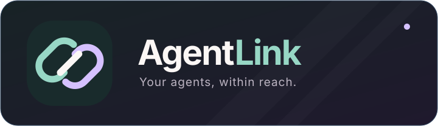

<p align="center">
  
</p>

<p align="center">
  <strong>Your coding agents. Your computer. Now on your phone.</strong><br>
  Start a task on Android, follow its progress, and continue the same chat in your browser or terminal.
</p>

<p align="center">
  <a href="https://github.com/gongpx20069/android-agent-link/releases"><strong>Download Android APK</strong></a>
  &nbsp; · &nbsp; <a href="README.zh-CN.md">中文</a>
  &nbsp; · &nbsp; <a href="docs/user-guide.md">User guide</a>
  &nbsp; · &nbsp; <a href="https://gongpx20069.github.io/hi-mochi/agentlink/"><strong>Official website</strong></a>
</p>

**GitHub Copilot CLI · Claude Code · Kimi Code · Qwen Code · DeepSeek Harness · OpenCode**

Multiple agents, projects and computers — connected through Android, a lightweight Web workspace, and an optional terminal.

**Upcoming coordinated App/Bridge update:** tool cards transfer only title/status
until expanded, with paged snapshots instead of continuous full-output downloads.
See [on-demand details](docs/user-guide.md#load-tool-details-only-when-needed).
This protocol change requires updating both ends; it is not in APK 0.0.50.

**Android image input (0.0.39+):** attach one screenshot/photo with optional text, preview
it and send it to an image-capable agent/model. Requires updated App **and** Bridge;
see [image input](docs/user-guide.md#send-an-image) for limits.

## Quick start

### 1. Download the app

Install `agentlink-0.0.x.apk` from the newest [Release](https://github.com/gongpx20069/android-agent-link/releases)
on your **Android 8.0+** phone. Releases are currently marked **Pre-release**.

### 2. Start the server on your computer

You need **Python 3.11+, Git, and at least one installed, configured coding agent**.
You do not need to install every agent; see [supported agents](#supported-coding-agents).
Your code and agent processes stay on this computer.

Run once in **Windows PowerShell**:

```powershell
git clone https://github.com/gongpx20069/android-agent-link.git
cd android-agent-link
python -m venv .venv
.\.venv\Scripts\python.exe -m pip install -e .\bridge
.\.venv\Scripts\python.exe .\bridge\run.py start
```

Already installed? Only the last command is needed on subsequent starts.
Follow the Dev Tunnels sign-in prompt if shown. The default connection is private
and authenticated: **no inbound firewall ports or extra VPN app on your phone**.
Keep the computer awake and this terminal running.

- `start` also enables the local Web workspace. Open its printed loopback URL
  and enter the Web access code. Use `start --no-web` for Server-only operation.
- The server prints a pairing QR code. On Android, open **Machines → Scan QR**.
  Check the matching confirmation code, then enter **`y`** at the server's pairing prompt.
- On Android, open **Chats → New Chat**. Choose the computer, agent, and a project
  path **on the computer**, such as `C:\Repos\my-project`, then send a message.

**You're ready to chat from your phone.** Terminal chat is optional.

### 3. Optional: chat from the terminal too

After any running tasks finish, stop the server with Ctrl+C. From the same repository
folder, install the terminal extra once and restart in interactive mode:

```powershell
.\.venv\Scripts\python.exe -m pip install -e ".\bridge[interactive]"
.\.venv\Scripts\python.exe .\bridge\run.py start --interactive
```

Open your chat on Android. With one chat and an empty terminal draft, it is selected
automatically: **just type to continue**. For multiple chats, use **`/chats`**.
If pairing is needed in this mode, use **`/qrcode`**, then Esc to return and
**`/pair y`** to confirm the matching code.

Phone and terminal share the same agent session, messages, task queue and approvals.
This is AgentLink's terminal UI, not a second independent agent-CLI conversation.

## Browser workspace

The updated stdlib Bridge's **`start` command includes Web by default**. Open
the printed local URL (normally `http://127.0.0.1:4318`) and enter its Web access
code. No Node service or frontend build is needed: it reuses the Python runtime.
Use `start --no-web` for Server-only operation, or `--web-port 0` for a free port.

See local and VM chats in one list, with computer labels, search and filters.
Drag to arrange chats, or use Alt+Up/Down; status updates do not reorder them.
Each chat keeps its own draft. Read replies and tool details, answer approvals,
rename chats, remove queued inputs or request task cancellation.

Add a VM in **computer management** using its current pairing link, check the
target and confirm on the VM. Each VM needs an updated stdlib Bridge. The browser
talks only to the local gateway; do not expose its Web port through a tunnel.
Remote credentials are stored in an owner-private file on that computer,
**not encrypted at rest**. An offline VM does not block the others.
For a first workspace, `--workspace-root C:\Repos` allows registering existing
subdirectories from New chat.

Web supports retained shared-journal history, Markdown tables/links, and pasting
or uploading one PNG/JPEG (up to 5 MiB / 16 million pixels) with optional text.
Images require a live image-capable session; native session picking remains in Android/the terminal.
Uncertain sends are never automatically retried, and closing the browser does
not cancel tasks. Update and deliberately restart the Bridge after existing work
finishes; updating the APK alone does not add Web.
[Full browser guide](docs/user-guide.md#browser-workspace).

## Built for moving between screens

| Stay in control | Pick up where you left off |
| --- | --- |
| Stream replies and inspect tool activity | Switch between computers, projects and chats |
| Approve agent requests from your phone | Resume sessions offered by your agent |
| Long-press on Android to copy selected text | Drag-select and scroll in the terminal |
| Keep queued messages compact; tap to expand | Read older history without loading it all at once |
| Answer approval requests in the browser too | Arrange local and VM chats manually in Web |

## Supported coding agents

Choose an agent when creating a chat. Each chat keeps its own agent, project and
session; switching chats does not move conversation context between providers.

| Agent | Computer setup | Session recovery |
| --- | --- | --- |
| **GitHub Copilot CLI** | Installed CLI with local sign-in; [native SDK connection](bridge/README.md#copilot-background-task-lifecycle) | Context and history |
| **Claude Code** | Local Claude authentication + [Claude ACP adapter](bridge/README.md#claude-code) | Context and history |
| **Kimi Code** | Current JavaScript Kimi Code + `kimi login`; [setup](bridge/README.md#kimi-code-and-qwen-code) | Context and history |
| **Qwen Code** | Qwen Code with local authentication; [setup](bridge/README.md#kimi-code-and-qwen-code) | Context and history |
| **DeepSeek Harness** | Pinned developer preview with local provider configuration; [setup](bridge/README.md#deepseek-harness) | Context only; no old-message replay |
| **OpenCode** | Native ACP with local provider authentication and permission rules; [setup](bridge/README.md#opencode) | Context and history |

This table describes **current source support**. Downloaded APKs follow their
release notes; new integrations may need a newer app **and** bridge. Version and
runtime requirements are in the setup links. An installed CLI is not proof of
successful model authentication.

Model, reasoning and permission choices depend on what each agent exposes.
AgentLink retains saved messages, but cannot retrieve DeepSeek Harness's external
session history. Phone and computer use AgentLink's shared terminal, not a mirror
of a separately running vendor CLI.

## More when you need it

| Looking for | Read |
| --- | --- |
| Terminal shortcuts, copying, models and permissions | [Terminal guide](docs/user-guide.md#chat-from-your-computer-too) |
| Sign in to find computers instead of scanning | [Account discovery and pairing](docs/user-guide.md#4-pair-your-phone) |
| Conda, uv, server-only mode or transport options | [Bridge setup](bridge/README.md#install) |
| Supported agent versions and compatibility | [Coding agents](docs/user-guide.md#coding-agents) |
| Updating, connection issues and troubleshooting | [User guide](docs/user-guide.md#need-help) |
| Optional Mochi control of shared chats | [Mochi integration](docs/user-guide.md#optional-mochi-integration) |
| Architecture, security and contributing | [Technical docs](docs/README.md) · [Contributor guide](CLAUDE.md) |

<details>
<summary>Before upgrading / connection limits</summary>

Signed releases can update previous signed releases in place. Do not uninstall
or clear app data to fix lag: that removes local history. Keep the app open during
the first load after upgrading; older APKs cannot read the migrated chat database.
Switching from a debug APK may require uninstalling it first.

The computer must stay online with the bridge running. QR tunnel credentials
can expire and require a fresh pairing code. Android background monitoring is
limited to one hour, not an always-on service. Account discovery remains a preview;
if it is unavailable, use QR pairing. Never enable anonymous tunnel access.

</details>

Found an issue? [Report it here](https://github.com/gongpx20069/android-agent-link/issues)
with the app version and error message — never include pairing links or tokens.
